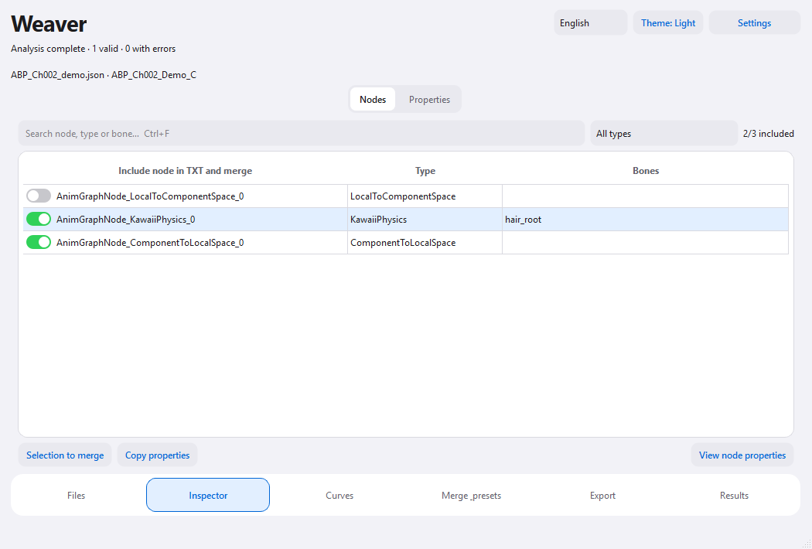
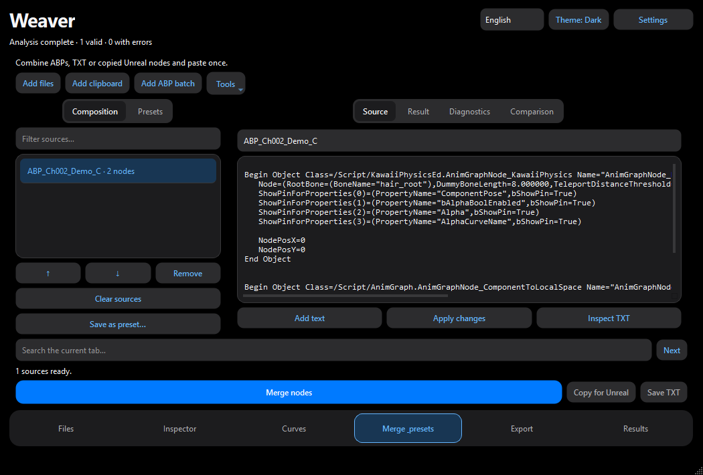

# Weaver · AnimGraph Studio

**Choose the animation nodes you need from an FModel export and paste them into Unreal Editor.**

[Download Weaver.exe for Windows](https://github.com/Alejandro07873/Weaver/releases/latest/download/Weaver.exe) · [Release notes](https://github.com/Alejandro07873/Weaver/releases/latest)

Windows x64 · English and Spanish · Light and dark themes

## 🧩 Your first export

1. Open **Weaver.exe**. In **Files**, add an Animation Blueprint JSON exported by FModel. To try the app, use the included [sample ABP](examples/ABP_Ch002_demo.json).
2. Open **Inspector** and check the nodes you want. You can search by name, type or bone.
3. Choose an output folder and click **Generate batch TXT**. Copy the result, open the destination AnimGraph in Unreal Editor and paste. Review the bones, assets and connections, then compile the blueprint.

## 🔗 Combine two ABPs

Open **Merge & presets** to combine nodes from two ABPs or from text copied in Unreal. You can compare the sources, save the combination as a preset and paste the result into your AnimGraph in one go.

## 🦴 Physics nodes and curves

Weaver supports MuscleEx and KawaiiPhysics editor nodes. Enable their plugins in the destination project. Use **Curves** to assign an external curve, such as the [sample damping curve](examples/CF_HairDamping.json). The [UE 4.27 node catalog](docs/NODES.md) lists the classes checked in the test project.

## 🔄 Updates

Weaver checks for stable releases when it opens. For a manual check, use **Files → Tools → Check for updates**. The Windows ZIP contains the same standalone executable as the direct download.

## Inside Weaver

Explore selected production code from the Windows app: the [Unreal project inspector](source-preview/weaver_project.py) checks referenced assets and enabled plugins, the [asset-reference helper](source-preview/weaver_serialization.py) translates FModel object paths, and the [release checker](source-preview/weaver_updates.py) looks for stable GitHub updates in the background.
